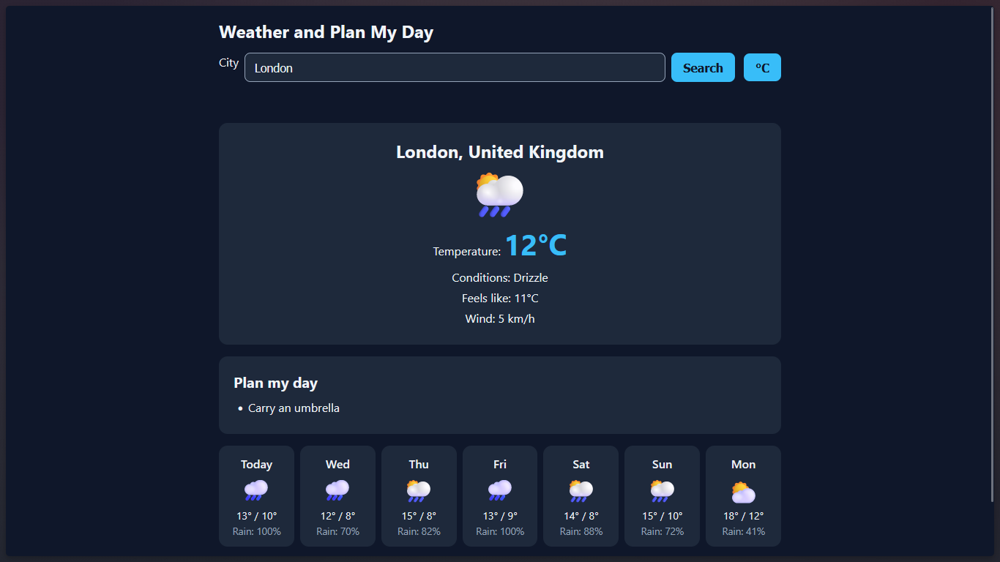

# Weather and Plan My Day

A responsive weather dashboard built for anyone looking to check current conditions, view a 7-day forecast, and get smart, rule-based daily planning tips.

**[Live demo](https://dkshkrr005.github.io/weather-dashboard/)**

## Features
- Real-time current weather data including temperature, "feels like" temperature, wind speed, and weather condition icons.
- Interactive 7-day forecast cards showing high/low temperatures, precipitation chances, and weekday names.
- Rule-based daily advice system offering smart tips (like carrying an umbrella or wearing sunscreen) based on weather conditions.
- Seamless unit toggle between Celsius and Fahrenheit that automatically re-fetches and syncs data.
- Persistent local storage that remembers and reloads your last successfully searched city on refresh.
- Fully responsive design with mobile-friendly layouts and error-handling for invalid searches or network issues.

## Built with
- HTML5
- CSS3 (Grid and Flexbox)
- Vanilla JavaScript (async/await, Local Storage API)
- Open-Meteo API

## How it works
When you enter a city name, the app calls the Open-Meteo Geocoding API to convert the name into geographic coordinates. It then passes those coordinates to the Open-Meteo Forecast API to retrieve current conditions and daily forecast data, which are parsed, rendered to the DOM, and evaluated to generate helpful planning advice.

## What I learned
- Managing asynchronous JavaScript operations cleanly using `async/await` and robust `try/catch/finally` error handling to ensure UI states (like loading buttons) always recover safely.
- Interacting with the browser's `localStorage` API to persist user preferences and session data across page refreshes.
- Building adaptive, mobile-first layouts using modern CSS Grid and Flexbox with media queries.

## Limitations and next steps
- Advice is driven by fixed rule-based thresholds rather than AI.
- Temperature unit preference is not yet saved to local storage.
- Wind speeds are displayed strictly in km/h.
- Automated unit tests have not been implemented yet.

## Credits
Weather data provided by [Open-Meteo.com](https://open-meteo.com/)